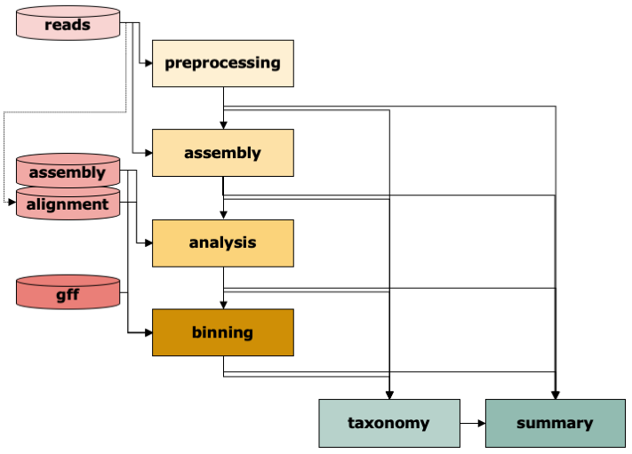

# IMP3

The **Integrated Meta-omic Pipeline (IMP3)** is a reproducible, modular Snakemake workflow for the integrated
analysis of coupled metagenomic (metaG) and metatranscriptomic (metaT) data. It covers read preprocessing, an
iterative (co-)assembly of metaG and metaT reads, gene calling and functional annotation, read-based and
contig-based taxonomy, binning into metagenome-assembled genomes (MAGs), and per-sample statistics.

{ width="620" }

IMP3 runs the whole workflow from raw reads, or only some steps, e.g. annotation and binning of an existing
assembly. It works with metaG and metaT together, with either one alone, and with long metaG reads.

| step | tools (default in bold) | details |
|---|---|---|
| [Preprocessing](steps/preprocessing.md) | **fastp**, BWA-MEM2 (PhiX and host filtering), SortMeRNA (rRNA, metaT), BBNorm (optional), Nonpareil, FastQC | trimmed, filtered reads per omic |
| [Assembly](steps/assembly.md) | **MEGAHIT**, iterative hybrid metaG + metaT assembly, **quickmerge** or CAP3, BWA-MEM2 | one assembly per sample, reads mapped back |
| [Analysis](steps/analysis.md) | **Bakta** gene calling, **Mantis** (KOfam, Pfam, eggNOG, NCBI, TCDB), featureCounts, mosdepth, bcftools | annotation, counts per gene and function, coverage, variants |
| [Taxonomy](steps/taxonomy.md) | **Kraken2 + Bracken** (reads and contigs), **mOTUs**, GTDB-Tk (bins) | community composition |
| [Binning](steps/binning.md) | CONCOCT, MetaBAT 2, MetaDecoder, SemiBin, COMEBin, binny → DAS Tool, **MetaWrap** refinement with CheckM2 | MAGs with quality and taxonomy |
| [Summary](steps/summary.md) | R / Python summaries | `Stats/all_stats.tsv`, `Stats/all_bin_stats.tsv` |

## Getting started

1. [Install IMP3](installation.md) and its [databases](databases.md), and run the test sample.
2. Describe your sample: [inputs](inputs.md) and [configuration](configuration.md).
3. [Run IMP3](running.md) locally or on a Slurm cluster, for one sample or many.
4. Find the results in the [output files](outputs.md); explore a whole study with the
   [IMP explorer](downstream.md).

## About

IMP3 is developed at the [Luxembourg Centre for Systems Biomedicine](https://www.uni.lu/lcsb-en/) (Systems
Ecology and BioCore) of the University of Luxembourg, with contributions from the Swammerdam Institute for Life
Sciences (University of Amsterdam) and the Helmholtz Centre for Environmental Research (UFZ). It continues IMP
([Narayanasamy et al. 2016, *Genome Biology* 17:260](https://doi.org/10.1186/s13059-016-1116-8)).
See [History and credits](about.md).
