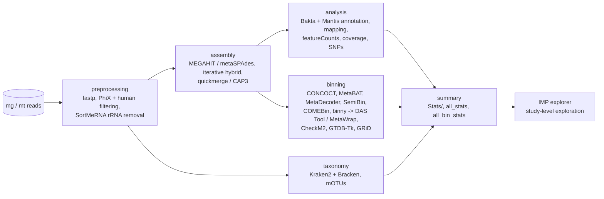

# IMP3

IMP3 is a reproducible Snakemake pipeline for the integrated analysis of metagenomic (mg) and metatranscriptomic (mt)
data: read preprocessing, a hybrid (mg + mt) assembly, gene annotation, read-based taxonomy, binning into
metagenome-assembled genomes (MAGs) and per-sample statistics. It also runs on metagenomes or metatranscriptomes
alone, and with long reads.

| step (`steps:` in the config) | what it does | main outputs |
|---|---|---|
| `preprocessing` | trimming and quality filtering (fastp), removal of PhiX and host reads, rRNA separation (SortMeRNA) for mt | `Preprocessing/` |
| `assembly` | iterative hybrid assembly of mg + mt reads, merging of assemblies, read mapping | `Assembly/` |
| `analysis` | gene calling and annotation (Bakta, Mantis: KEGG, CAZy, Pfam, …), featureCounts per function, coverage, variants | `Analysis/annotation/`, `Analysis/snps/`, `Stats/` |
| `taxonomy` | Kraken2 + Bracken per rank, mOTUs profiles, Kraken2 on contigs | `Analysis/taxonomy/` |
| `binning` | several binners, refinement (DAS Tool, MetaWrap), CheckM2, GTDB-Tk, GRiD | `Binning/`, `Stats/all_bin_stats.tsv` |
| `summary` | statistics and reports | `Stats/all_stats.tsv` |

## Where to go next

- [Installation and test run](installation.md)
- [Configuration](configuration.md) and [running on a cluster](running.md)
- [Output files](outputs.md)
- [Downstream: IMP explorer and sRNA-IMP](downstream.md)

## Licence and history

MIT licence (Helmholtz Centre for Environmental Research (UFZ) & Luxembourg Centre for Systems Biomedicine (LCSB)).
IMP3 continues IMP ([Narayanasamy et al. 2016, Genome Biology](https://doi.org/10.1186/s13059-016-1116-8)).
Development moved from GitLab to [GitHub](https://github.com/genomeanalysislcsb/IMP3) with its full history.
