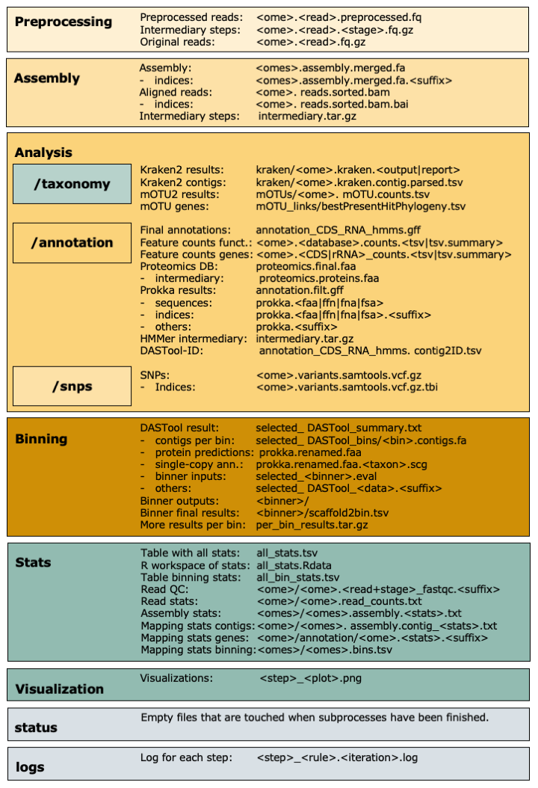

.. _output:

=========================
Overview of IMP3's output 
=========================

Once you run IMP3, it will fill the output directory with the intermediary outputs and results. Before the end,
it will compress some of the intermediary steps. Finally, it will make some summaries and visualizations (if you want).
Here's an overview of the all outputs:

