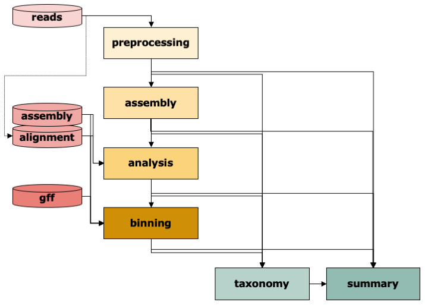

.. _steps_overview:

======================
Overview of IMP3 steps
======================

.. toctree::
   :maxdepth: 1
   :caption: Overview of IMP3 steps
   :hidden:
   :name: steps_IMP3

   Preprocessing
   Assembly
   Analysis
   Binning
   Taxonomy
   Summary

The workflow of IMP3 consists of six modules: :ref:`pre-processing <step_preprocessing>` of reads
, :ref:`assembly <step_assembly>`, :ref:`analysis <step_analysis>` of contigs including
functional annotation, :ref:`binning <step_binning>` of contigs, determination of :ref:`taxonomy <step_taxonomy>` at
various levels, and :ref:`summary <step_summary>` including visualization.
Typically, you will supply IMP3 with reads and it will run through the whole workflow.

Given the appropriate :ref:`input<input_options>` , you can also run most steps independently. For instance, you may have
already processed reads and are looking to assemble and annotate them. You'd then select only assembly and analysis from the
steps (and potentially summary). You can also supply an assembly that you may want to have
annotated and binned. Or an annotated assembly that you want binned etc. Just enter your
input data and select the steps in the :ref:`config <configuration>` file and IMP3 will take care of it.

To get an impression of all steps of a run with metagenomics and metatranscriptomics reads (hybrid assembly),
download :download:`this file <../figures/hybrid_dag.pdf>`.

