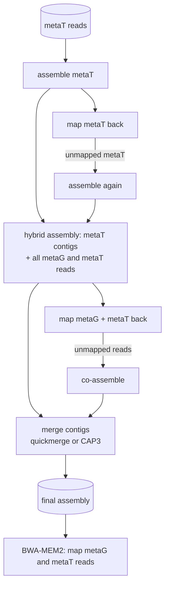

# Assembly

IMP3 uses the iterative assembly of the original IMP: reads that do not map to the first assembly are assembled
again, and both sets of contigs are merged. This gives longer contigs without losing quality
([Narayanasamy et al. 2016](https://doi.org/10.1186/s13059-016-1116-8)). Output:
`Assembly/{mgmt,mg,mt}.assembly.merged.fa` and the reads mapped back to it.

## Iterative multi-omic hybrid assembly (metaG + metaT)

The default for samples with both omics (`assembly.hybrid: true`):

1. The metaT reads are assembled, mapped back, and the unmapped metaT reads are assembled a second time.
2. The metaT contigs of both rounds are given to the hybrid assembly together with all metaG and metaT reads.
3. All reads are mapped to the hybrid contigs; unmapped metaG and metaT reads are co-assembled.
4. The contigs of both hybrid rounds are merged (`assembly.merge`: **quickmerge** or CAP3).
5. Both omics are mapped to the final contigs with BWA-MEM2.

The assembler is **MEGAHIT** (default) or metaSPAdes (`assembly.assembler`); the k-mer settings are under
`assembly`.

## Single-omic assembly (metaG or metaT)

With one kind of reads (or both but `hybrid: false`, then the metaG reads are assembled): assemble, map back,
assemble the unmapped reads again, merge both contig sets, map the reads to the final contigs. In the non-hybrid
case with both omics, metaG and metaT reads are both mapped to the metagenomic assembly.

## Short + long metaG reads

With `LongReads` and `assembler: metaspades`, metaSPAdes co-assembles long and short metaG reads in the first
round; only the short reads are mapped back and used in the second round.

## After the assembly

Contig lengths, GC content, read counts and depth per contig (hts-nim-tools, mosdepth, BEDTools) and the
mapping statistics are written to `Stats/` (see [Output files](../outputs.md)).
