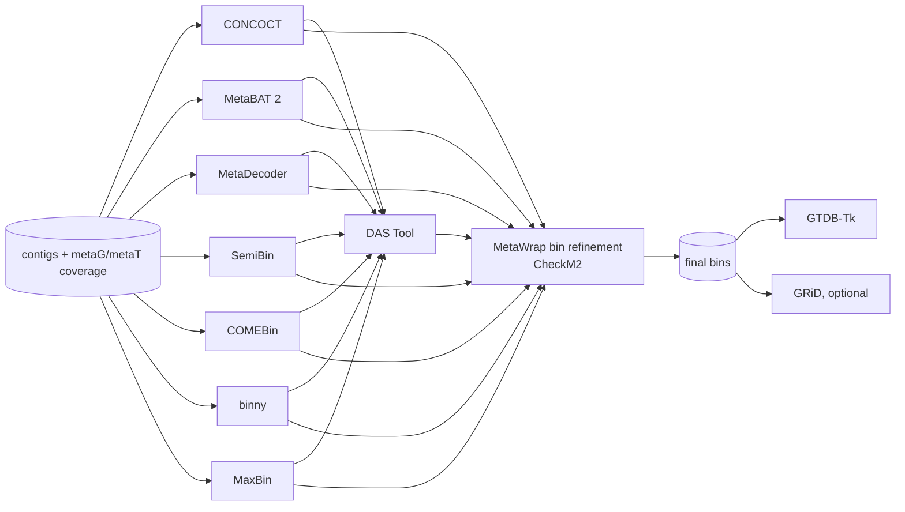

# Binning

Contigs are grouped into metagenome-assembled genomes (MAGs) by several binners; the bins are combined and refined,
checked for completeness and contamination, and classified. Output: `Binning/`, `Stats/all_bin_stats.tsv`.

1. **Binners**: the binners in `binning.binners` run on the contigs above their length cut-off, using metaG and
   metaT coverage: [CONCOCT](https://github.com/BinPro/CONCOCT), [MetaBAT 2](https://bitbucket.org/berkeleylab/metabat),
   [MetaDecoder](https://github.com/liu-congcong/MetaDecoder), [SemiBin](https://github.com/BigDataBiology/SemiBin),
   [COMEBin](https://github.com/ziyewang/COMEBin), [binny](https://github.com/a-h-b/binny) and
   [MaxBin 2](https://sourceforge.net/projects/maxbin2/). Each writes `Binning/<binner>/contig2bin.tsv`.
2. **Combination and refinement**: [DAS Tool](https://github.com/cmks/DAS_Tool) selects a non-redundant set from all
   binners; [MetaWrap](https://github.com/bxlab/metaWRAP)'s bin refinement, with
   [CheckM2](https://github.com/chklovski/CheckM2) quality estimates, produces the final bins
   (`binning.MetaWrap.min_completeness` 60 %, `max_contamination` 10 %).
3. **Taxonomy and growth**: [GTDB-Tk](https://github.com/Ecogenomics/GTDBTk) classifies the final bins;
   [GRiD](https://github.com/ohlab/GRiD) estimates growth rates when enabled.

The final bins are in `Binning/MetaWrap/` (`bins/`, `bins.contigs` = contig → bin), all per-bin results in
`Binning/per_bin_results.tar.gz`, and one table of all bins (completeness, contamination, N50, size, GC, GTDB
classification, closest reference) in `Stats/all_bin_stats.tsv` and `Stats/mgmt/mgmt.bins.tsv`.
