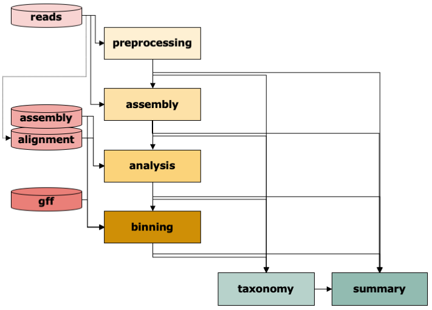

# Overview of the steps

{ width="620" }

IMP3 has six steps, chosen with `steps` in the [config](../configuration.md). A typical run starts from raw reads
and runs all of them; with the matching [inputs](../inputs.md) most steps also run alone, e.g. `analysis binning
taxonomy summary` on an existing assembly.

| step | page |
|---|---|
| `preprocessing` | [Preprocessing](preprocessing.md) |
| `assembly` | [Assembly](assembly.md) |
| `analysis` | [Analysis](analysis.md) |
| `taxonomy` | [Taxonomy](taxonomy.md) |
| `binning` | [Binning](binning.md) |
| `summary` | [Summary](summary.md) |

To see every Snakemake rule of a run, let Snakemake draw the graph:
`snakemake -s Snakefile --configfile sample.yaml --rulegraph | dot -Tpdf > rules.pdf`.
