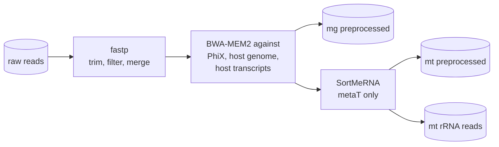

# Preprocessing

Raw reads of each omic are trimmed and quality-filtered, cleaned of PhiX and host reads, and, for metaT, split into
rRNA and non-rRNA reads. Output: `Preprocessing/{mg,mt}.{r1,r2,se}.preprocessed.fq.gz`.

## Trimming and quality filtering (fastp)

[fastp](https://github.com/OpenGene/fastp) trims adapters (auto-detected unless given), cuts low-quality ends,
removes reads with too many low-quality or N bases and reads shorter than 40 nt, and merges overlapping pairs.
Pairs where one read is removed leave a singleton; the singletons of R1 and R2 are written to one `se` file, so
paired data always gives three files (`r1`, `r2`, `se`). Settings: `fastp` in the [config](../configuration.md#preprocessing).

## Filtering of PhiX and host reads

With `preprocessing_filtering: true`, reads are mapped with [BWA-MEM2](https://github.com/bwa-mem2/bwa-mem2) to the
references in `filtering.filter` (default `PhiX T2TCHM13v2genomic T2TCHM13v2transcripts`), one after the other.
Pairs and singletons are mapped separately; a pair is removed if either read maps. Only unmapped reads are kept;
the host reads and alignments are not.

## rRNA reads of the metatranscriptome (SortMeRNA)

[SortMeRNA](https://github.com/biocore/sortmerna) separates rRNA reads from the other metaT reads (databases in
`sortmerna.files`). rRNA is abundant, assembles poorly and is depleted with varying success during library
preparation, so rRNA reads are left out of the assembly; they are kept in `Preprocessing/mt.*.trimmed.rrna.fq.gz`.
`keep_rrnas: true` keeps them in the preprocessed reads.

## Optional and QC steps

- **FastQC** on raw and preprocessed reads, **Nonpareil** sequence-coverage estimates of the metagenome
  (`Stats/mg/mg.r{1,2}_nonpareil.*`), and read statistics per step (`Stats/{omic}/{omic}.read_stats.tsv`).

All FASTQ files are gzipped at the end of the step.
