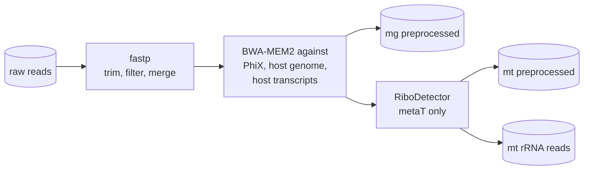

# Preprocessing

Raw reads of each omic are trimmed and quality-filtered, cleaned of PhiX and host reads, and, for metaT, split into
rRNA and non-rRNA reads. Output: `Preprocessing/{mg,mt}.{r1,r2,se}.preprocessed.fq.gz`.

## Trimming and quality filtering (fastp)

[fastp](https://github.com/OpenGene/fastp) trims adapters (auto-detected unless given), cuts low-quality ends,
removes reads with too many low-quality or N bases and reads shorter than 40 nt, and merges overlapping pairs.
Pairs where one read is removed leave a singleton; the singletons of R1 and R2 are written to one `se` file, so
paired data always gives three files (`r1`, `r2`, `se`). Settings: `fastp` in the [config](../configuration.md#preprocessing).

## Filtering of PhiX and host reads

With `preprocessing_filtering: true`, the references in `filtering.filter` (default `PhiX T2TCHM13v2genomic
T2TCHM13v2transcripts`) are removed one after the other. Pairs and singletons are filtered separately; only the reads
that are kept are written, not the host reads or alignments.

`filtering.method` decides how reads are matched to the references:

- `deacon` (default since 3.1.0): the host genome and transcriptome steps
  (`filtering.deacon_steps`) use [Deacon](https://github.com/bede/deacon) (Constantinides et al. 2025), which compares
  the minimizers of each read pair with an index of the human pangenome (`panhuman-1`: 47 HPRC haplotypes, CHM13v2 and
  GRCh38; minimizers shared with bacteria and viruses removed) and removes the pair with ≥ 2 hits covering ≥ 1 % of
  its minimizers; the first host step removes the host reads, later host steps pass the reads on. PhiX and any other
  reference are filtered with Deacon as well, against an index of the reference itself
  (`<db>/filtering/deacon/<reference>.k31w15.idx`, built by the installer or on first use).
- `bwa`: BWA-MEM2 for every reference; a read counts as aligned only when ≥ 80 % of its length aligns
  (`bwa_min_aligned_fraction`), ≥ 30 bases (`bwa_min_aligned_length`), with ≤ 5 % mismatches
  (`bwa_max_mismatch_fraction`); a pair is removed when either mate counts, and the other mate is not lost.
- `bwa_any` (IMP3 ≤ 3.0.3): a pair is removed when BWA-MEM2 reports
  either mate as mapped (any local alignment above its minimum score); a mate without alignment whose partner aligned
  is discarded as well.

With `bwa_any`, BWA-MEM2's pairing and mate rescue mark many microbial pairs from short-insert libraries as mapped. On
10 Expobiome stool metagenomes (2 M pairs each; median insert ~320 bp, 21–71 % overlapping mates) it removed 12–31 %
of the pairs, most of them pairs whose reads had been shortened by adapter trimming; Deacon and
[Hostile](https://github.com/bede/hostile) (bowtie2 end-to-end, T2T + HLA masked against microbes) agreed on
0.02–1.1 % human reads, and `bwa` removed 0.01–0.1 %, matching them in every read-length class. The loss under
`bwa_any` depended on genome GC (low-GC Bacillota lost up to ~30 %, Bifidobacterium ~8 %). A cohort with longer
inserts (MiBiPa, median ~430 bp) lost 1–14 %. Metatranscriptomes are short-insert by construction: on three Expobiome
samples (72–79 % overlapping mates) `bwa_any` removed 44–53 % of the non-rRNA pairs, `bwa` and Deacon 0.04–0.12 %.
Use `deacon` (or `bwa`) for new runs; with `bwa_any` the removed
share is not a measure of host DNA.

## rRNA reads of the metatranscriptome (RiboDetector)

[RiboDetector](https://github.com/hzi-bifo/RiboDetector) separates rRNA reads from the other metaT reads (a deep
learning model, no database). rRNA is abundant, assembles poorly and is depleted with varying success during library
preparation, so rRNA reads are left out of the assembly; they are kept in `Preprocessing/mt.*.trimmed.rrna.fq.gz`.
`keep_rrnas: true` keeps them in the preprocessed reads.

## Optional and QC steps

- **FastQC** on raw and preprocessed reads, **Nonpareil** sequence-coverage estimates of the metagenome
  (`Stats/mg/mg.r{1,2}_nonpareil.*`), and read statistics per step (`Stats/{omic}/{omic}.read_stats.tsv`).

All FASTQ files are gzipped at the end of the step.
